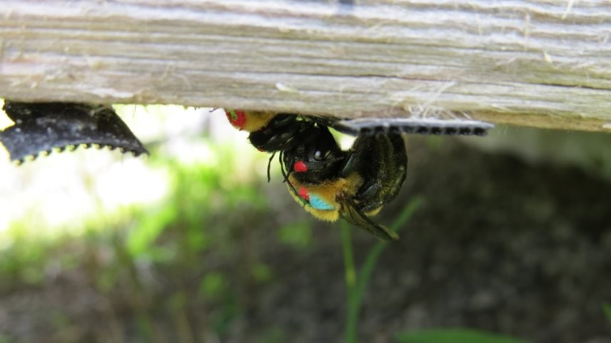
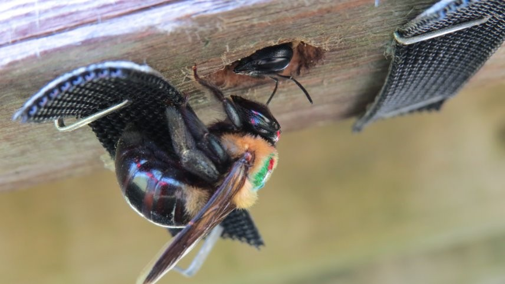
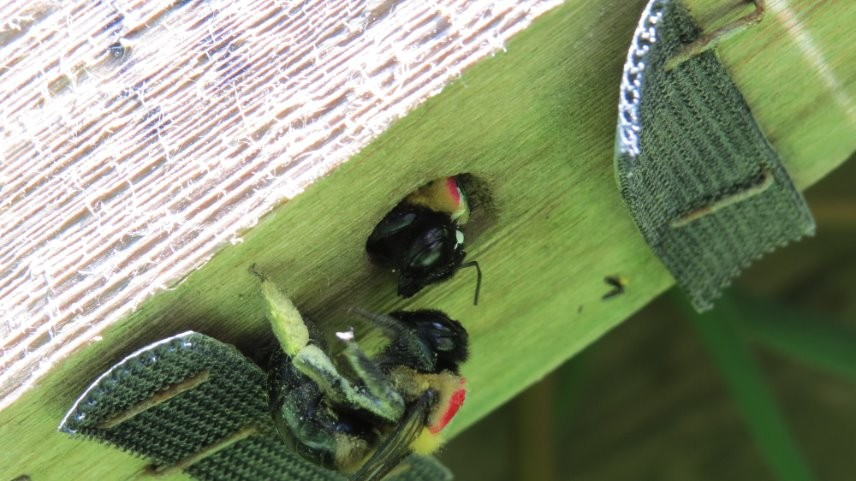
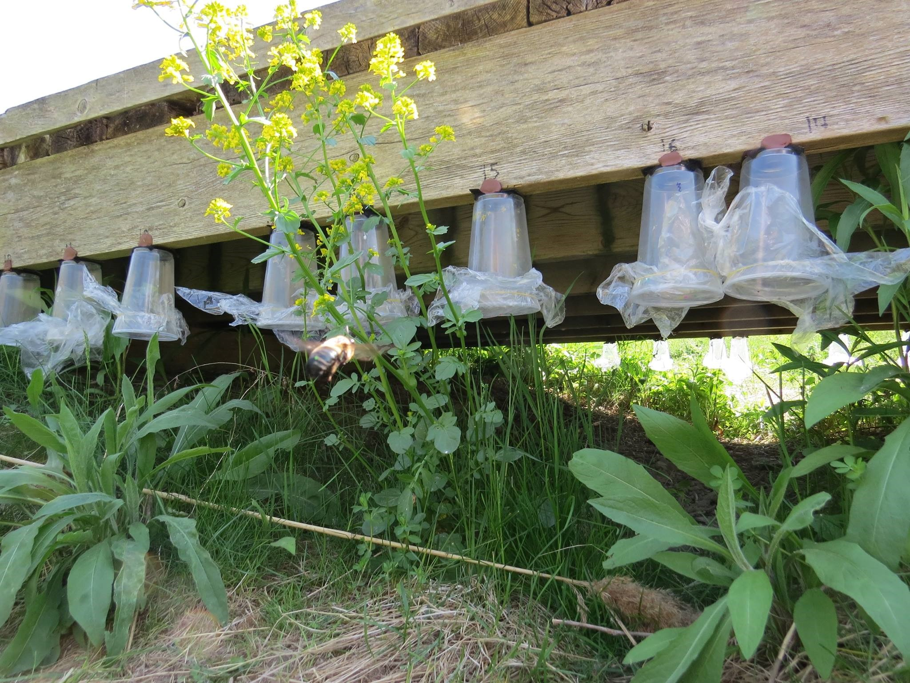
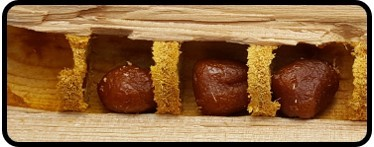
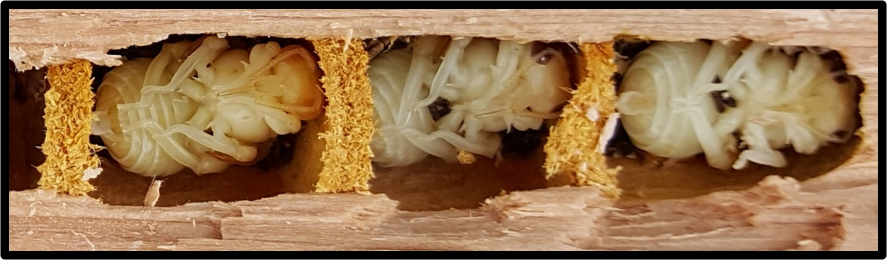
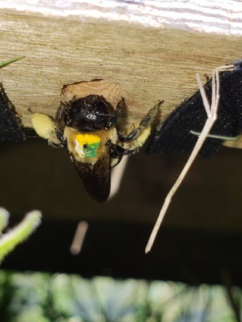
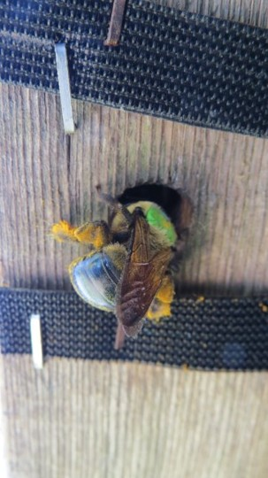
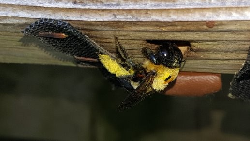

## Social Groups

::: {.columns}

::: {.column}

{fig-cap="Field observation from a long-term study population."}
:::

::: {.column}

{fig-cap="Individuals associated within a social group. These observations help reveal how social relationships are formed and maintained."}

:::

::: {.column}

{fig-cap="Group-living carpenter bees. Long-term observations allow researchers to track partner fidelity and changes in social structure through time."}

:::

:::

## Behaviour

{fig-align="center" width="70%" fig-cap="Field observation used to investigate behavioural ecology of territorial males, RHP, and territorial contests for access to mates in carpenter bees."}

## Nesting Biology

::: {.columns}

::: {.column}

{fig-cap="Brood cells containing pollen provisions prepared by a female carpenter bee. These provisions support larval development before pupation."}

:::

::: {.column}

{fig-cap="Developing pupae within brood cells. Examination of brood development would help link reproductive investment to environmental and ecological conditions."}

:::

:::
## Other Field Observations

::: {.columns}

::: {.column}

{fig-cap="Field observation from a long-term study population."}

:::

::: {.column}

{fig-cap="Monitoring marked individuals allows us to examine behaviour, nest fidelity, and dispersal."}

:::

::: {.column}

{fig-cap="Field studies connect individual behaviour with population-level patterns of social organization."}

:::

:::