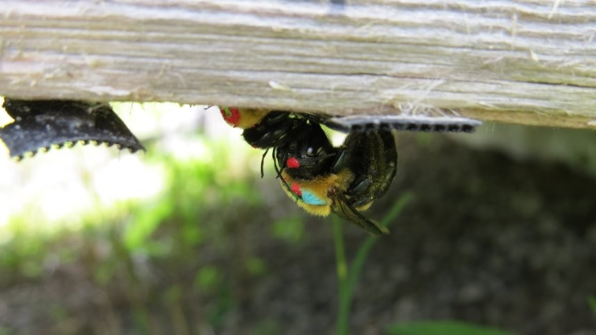
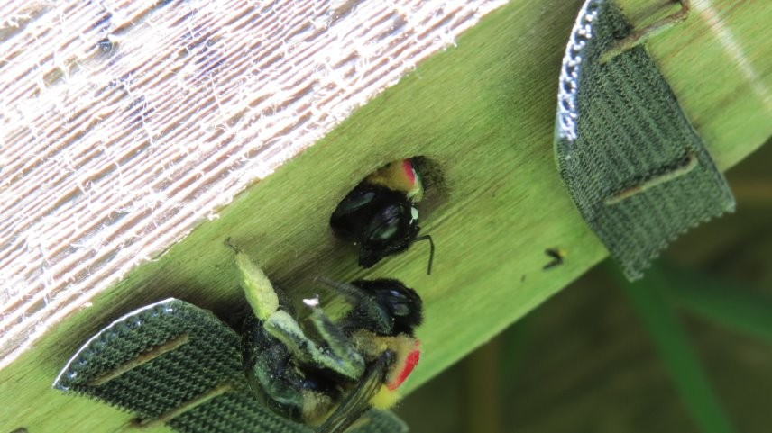
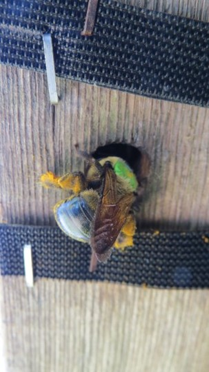
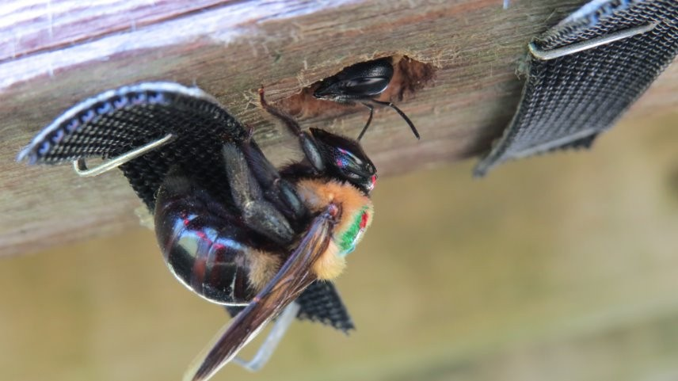

My research examines how ecological and evolutionary processes shape social organization in facultatively social carpenter bees. I am particularly interested in how individual behavioural decisions scale to population-level social structure, and how patterns of cooperation, dispersal, and reproduction contribute to the formation and maintenance of social groups.

Using long-term field studies, behavioural observations, social-network approaches, and statistical modelling, my work focuses on facultatively social carpenter bees as a model system for understanding the origins and maintenance of sociality.

::: {.feature}
::: {.feature-img}
{fig-alt="Eastern carpenter bee in the field"}
:::
::: {.feature-text}
## Social organization in carpenter bees

Understanding how reproductive behaviour, nest use, and social interactions contribute to the formation and maintenance of social groups.
:::
:::

::: {.feature .reverse}
::: {.feature-img}
{fig-alt="Several carpenter bees sharing a nesting area"}
:::
::: {.feature-text}
## Sleeping associations and social networks

Many bees aggregate overnight in shared resting sites, yet the social structure of these associations remains poorly understood.

My current work examines sex-specific patterns of sleeping associations in carpenter bees. Using social-network methods, I investigate questions including:

- Do individuals associate non-randomly with preferred partners?
- How stable are sleeping associations through time?
- Do males and females differ in partner fidelity?
- How does social structure vary among years?

These studies provide insight into the social relationships that occur outside of reproductive and foraging contexts.
:::
:::

::: {.feature}
::: {.feature-img}
{fig-alt="Marked carpenter bee used in studies of movement and nest fidelity"}
:::
::: {.feature-text}
## Nest fidelity, dispersal, and partner fidelity

Movement among nests can have important consequences for social structure, kin interactions, and opportunities for cooperation. My research investigates:

- Patterns of nest fidelity across years
- Rates of dispersal among nesting sites
- Sex differences in nest-use behaviour
- The relationship between nest-switching and social partner fidelity

Understanding how individuals move through populations provides an important link between behavioural decisions and population-level social organization.
:::
:::

::: {.feature .reverse}
::: {.feature-img}
{fig-alt="Brood cells containing pollen provisions"}
:::
::: {.feature-text}
## Environmental drivers of behaviour and reproduction

Environmental conditions influence behaviour at both individual and population levels. My research explores how variation in factors such as climate, weather, and resource availability affects:

- Maternal investment
- Reproductive output
- Nest occupancy patterns
- Social organization

By integrating ecological and behavioural data, I seek to understand how environmental variation shapes social evolution.
:::
:::

::: {.feature}
::: {.feature-img}
{fig-alt="Eastern carpenter bee at a nest entrance"}
:::
::: {.feature-text}
## Current study system

Most of my research focuses on large carpenter bees (*Xylocopa virginica*), a species that exhibits remarkable variation in social behaviour ranging from solitary nesting to cooperative social groups.

This behavioural flexibility makes carpenter bees an excellent system for investigating the ecological and evolutionary processes that shape social evolution.
:::
:::

## Methods

My research integrates a variety of complementary approaches:

::: {.chips}
[Long-term field studies]{.chip}
[Individually marked populations]{.chip}
[Social-network analysis]{.chip}
[Generalized linear mixed models]{.chip}
[Longitudinal behavioural datasets]{.chip}
[Spatial analysis of nest use]{.chip}
[Demographic modelling]{.chip}
:::

Together, these approaches provide a framework for linking individual decision-making to population-level patterns of social organization.
